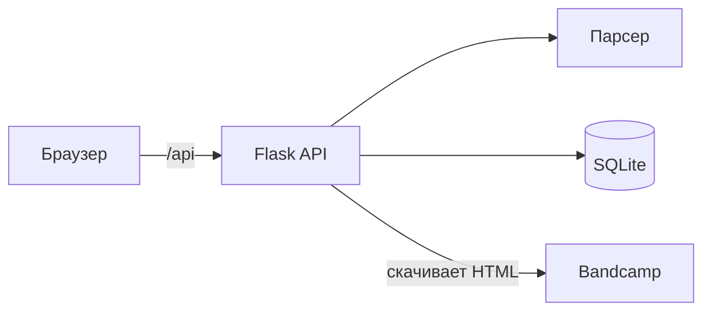

# Архитектура

## Обзор

Приложение состоит из фронтенда (Svelte), бэкенда (Flask API) и хранилища (SQLite). Фронтенд обращается к API, API парсит страницы Bandcamp и сохраняет отчёты.

## Диаграмма

## Компоненты

| Компонент | Назначение |
|---|---|
| Svelte SPA | Форма URL, карточка релиза, история отчётов |
| Flask + flask-smorest | REST API, OpenAPI/Swagger |
| parser.py | Разбор HTML, сбор ошибок |
| SQLite | Таблица `reports` |

## Поток данных

1. Браузер отправляет запрос к Flask API.
2. Flask скачивает HTML и вызывает парсер.
3. Парсер возвращает словарь.
4. Flask сохраняет отчёт в SQLite и отвечает JSON.
5. SPA отрисовывает карточку.

## API

- `POST /api/parse` — распарсить URL и сохранить отчёт.
- `GET /api/reports` — список отчётов.
- `GET /api/reports/{id}` — один отчёт.
- `DELETE /api/reports/{id}` — удалить отчёт.
- `GET /api/health` — проверка живости.

## Расширение

Загрузка аудио планируется через заглушку `AudioDownloader` в `parser.py`. Парсер и API при этом не меняются.